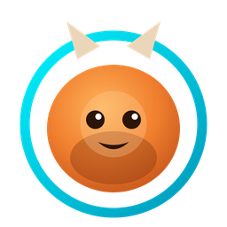

# OiShi-e! (The AR Muse)



OiShi-e! is an AR creature companion that lives inside your everyday life. Point your camera at any real object — a mug, a plant, a street sign — and Meta's Muse Spark model looks at it and hatches a unique "Muse" creature with its own element, stats, personality and voice.

Your creature then grows with what you actually do: it reacts to places you visit, keeps a daily diary of your day, dances, battles wild creatures, and levels up through a hybrid system (role-based rules + your real activity + AI-tuned weights) — no menus to micro-manage.

The problem: most "healthy habit" and lifestyle apps feel like chores, and most AR games end when you close the app. OiShi-e! turns ordinary moments into play, and lets a companion nudge at the right time (e.g. telling you to stop drinking or to call a designated driver) through a character you actually care about. In-game tokens reward everyday actions, designed to connect to the Meta platform economy.

일상을 플레이로 바꾸는 AR 크리처 동반자 (Next.js + three.js).

## Built with Meta

- Muse Spark (muse-spark-1.3) via Meta Model API: the core brain. It analyzes camera captures to generate creatures (/api/look, /api/creature), writes the creature's daily diary (/api/diary), reacts to feeding (/api/feed), and drives battle commentary and AI decisions (/api/battle).
- Muse Image via Meta Model API (images/generations): generates creature art and skins.
- Meta Model API audio transcription: voice commands to your creature (/api/voice).
- Llama Guard: safety gate for user-authored creature skins (UGC moderation).
- Muse Code: used as our coding agent to build the app across multiple parallel sessions.

## External services & graceful degradation

Full table: [docs/EXTERNAL_APIS.md](docs/EXTERNAL_APIS.md).
All AI routes return 200 + a rule-based stand-in (`fallback: true`) when the key is missing or upstream fails, so the game never stalls.
Local bundles (`public/vendor/`) replace the draco/MediaPipe CDNs for offline builds; live status is on the lounge "외부 연결 상태" panel (`/camp`).


## Run (local)

```bash
npm ci
# Windows: copy .env.example .env / mac·Linux: cp .env.example .env
# then put your key in .env: MODEL_API_KEY=...
npm run dev
# http://localhost:3000
```

Pages: explore & battle (`/pov`), creature dex with dance compare (`/dex`), camp (`/camp`), login (`/login`), battle demo (`/battle-demo`).

Phone demo (same Wi-Fi): on the PC run `npm run serve:lan`, then enter the shown address + 6-digit code in the APK.

## 배포 4종

Releases: v1.0-submission (제출 확정 후 링크 기입 — APK·exe 바이너리는 여기에만 올린다. 외부 서버 배포 없음.)

- 웹(PC 크롬): 이 저장소 소스로 `npm run dev` 실행. AI 호출·토큰 장부는 PC 서버에서만 돈다.
- 안드로이드 APK: 같은 와이파이의 PC 서버에 붙는 "PC 허브 + 폰 AR" 구조. 디버그 APK는 Releases에서 받는다.
- Ray-Ban 호환: 같은 APK + 블루투스 안경 마이크/스피커(HFP). `?hud=rayban` 규약. 실기기 테스트 전(설계/예정).
- Windows exe: PC 내장 Next 서버 + Electron 설치본. 설치 후 실행하면 웹과 같은 화면.
- DAT 카메라(안경 카메라 직접 연동): 설계/예정 — 이 제출에는 포함되지 않는다.

데모 토큰: 화면의 "뮤즈 토큰"은 데모 토큰이다(실제 결제·정산 없음). 플랫폼 공용 토큰은 Meta 몫이며, 이 앱은 실행 가능성만 보인다.

## 핵심 파일 지도

- `app/pov/page.tsx` — 탐험·배틀 메인 화면 (스캔·음성·배틀).
- `app/dex/page.tsx` — 도감 + 춤 비교. `app/camp/page.tsx` — 캠프(토큰·외부 연결 패널).
- `app/api/creature|look|diary|feed|battle|voice/route.ts` — AI 라우트 (키 없으면 200 + `fallback:true`).
- `app/api/muse/ask/route.ts` — 음성 질문 이해 (VA-1/VA-2).
- `lib/muse.ts` — Meta Model API 호출 공통. `lib/ask/intents.ts` — 질문 intent 9종.
- `lib/token/` — 토큰 장부·시뮬레이션 구역. `lib/places/` — 충전처·힙한 곳 근거 목록.
- `lib/external/registry.ts` — 외부 API 등록부 ([표](docs/EXTERNAL_APIS.md) 원천).
- `components/CaptureBox.tsx` — 포획 상자. `components/PovCreature.tsx` — 크리처 3D.
- `scripts/verify-*.mjs` — 기능별 검증 스크립트 (아래 실행법).
- `electron/` — Windows exe 포장. `android/` — APK 래퍼 소스. `docs/EXTERNAL_APIS.md` — 외부 API 표.

## 검증 스크립트 실행법

```bash
node scripts/verify-voice-ask.mjs   # VA 음성 질문 (종료 코드 0 = 통과)
node scripts/verify-battle.mjs      # 배틀 엔진
node scripts/verify-sec.mjs         # 보안 게이트
```

## Credits

- `Music: "Call to Adventure" Kevin MacLeod (incompetech.com), licensed under CC BY 4.0`
- `Battle music: generated with ACE-Step (Apache 2.0)`
- `Meme audio/video © original creators, used as parody/reference`
- `Viewfinder tracking: 1eurofilter (BSD-3-Clause, https://github.com/casiez/OneEuroFilter)`
- `Battle HUD springs: motion 11.18.2 (MIT, https://github.com/motiondivision/motion)`
- `Battle display font: Jua + Baloo 2 (OFL, Google Fonts, self-hosted in public/fonts — next/font metadata lacks Jua korean subset in Next 14.2)`
- `Skill icons: game-icons.net Lorc (CC BY 3.0) — public/icons/ATTRIBUTION.md`
- `UI icons (flee/battle/distance): Lucide path inline (ISC, https://lucide.dev)`
- `Android wrapper: Capacitor core/cli/android (MIT, https://github.com/ionic-team/capacitor)`
- `In-app speech: @capacitor-community/speech-recognition (MIT, https://github.com/capacitor-community/speech-recognition)`
- Walk background videos: Pexels License clips (free commercial use, no attribution) — see `public/videos/CREDITS.txt`.

## Not in this repo

- Song originals and reference-only media (BGM candidates, battle original, J Black clip, dance reference clips except the two dex compare clips).
- Reference image sets, scratch folders, local token ledger, local certificates.
- `.env` and any key files. Never commit keys.
- Build outputs (APK·exe): see Releases.

## Security notes

- next 14.2.35 + Image Optimization disabled (`images.unoptimized`), local-only server (`HOSTNAME 127.0.0.1`).
- Remaining next advisories need a 15.x upgrade (planned after submit; 15/16 require React 19 + routing changes).
- No keys in repo (`.env` untracked). Session cookies are HMAC-signed; upstream error bodies stay in server logs.
- LAN demo pairing: 6-digit code + HttpOnly cookie, AI rate limits, body caps (see `middleware.ts`).

마지막 업데이트: 2026-11-05 00:40
