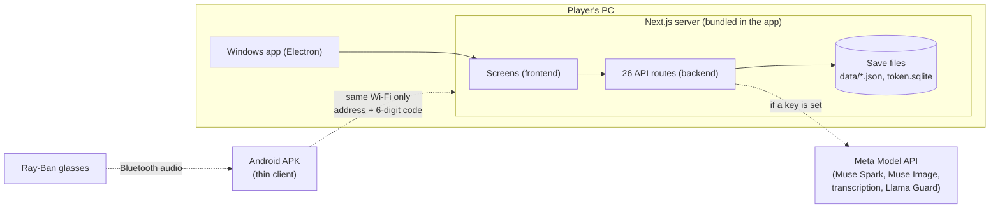
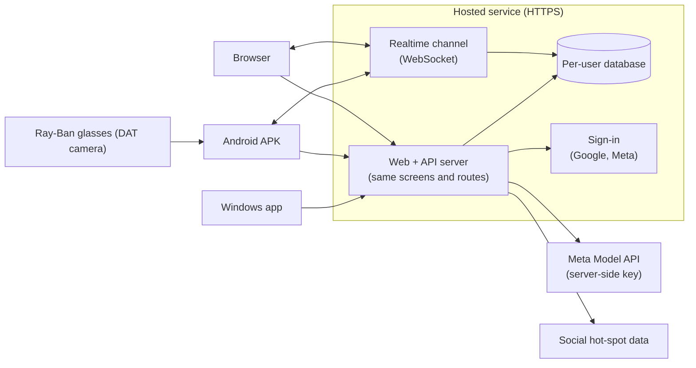

# OiShi-e!


**Turn everyday objects into an AR creature companion.**

Point your camera at a real object (a mug, a plant, a storefront). Meta's Muse Spark model looks at it and hatches a unique creature with its own element, stats, personality and voice. Your creature grows with what you actually do: it reacts to places you visit, keeps a diary of your day, dances, battles wild creatures, and answers your voice questions.

Healthy-habit apps often feel like chores, and most AR games end when you close the app. OiShi-e! turns ordinary moments into play, and a companion you care about can nudge you at the right time, for example to drink water or to call a designated driver.

## Features

- **Scan & hatch:** capture a real object and generate a creature from it (`/pov`).
- **Explore & battle:** find wild creatures on the walk-around map and battle them.
- **Dex & dance:** a creature dex with dance comparison (`/dex`).
- **Camp:** tokens and the external-connection status panel (`/camp`).
- **Voice:** ask your creature questions by voice (`/api/voice`, `/api/muse/ask`).
- **Diary & care:** feeding, daily diary and personality that changes with your activity.

Demo video: link coming soon.

## Submission history

| When | What | Commit / place |
|---|---|---|
| **Deadline submission** (2026-11-05 01:04) | Full source code and README | [`ca741cb`](https://github.com/syndgo-byte/Muse_Meta_Hackerton/tree/ca741cb) |
| After the deadline (2026-11-06 20:35) | Background music and walk videos added to the repo (already inside the installer) | `ba4bbf8` |
| After the deadline (2026-11-06 20:36) | Two dance reference clips added to the repo (already inside the installer) | `5167b41` |
| After the deadline (2026-11-06 20:46) | `web/data/places/hip.json` added so the web build works from a clean clone (already inside the installer) | `2c998fa` |
| After the deadline (2026-11-06 23:36) | Installer and APK built on 2026-11-04 uploaded to Releases as they were | [Releases `v1.0-submission`](https://github.com/syndgo-byte/Muse_Meta_Hackerton/releases/tag/v1.0-submission) |
| After the deadline (2026-11-06) | README: this history, limits, current and planned structure | README only |

These files had been left out of the upload, not changed. No app code was changed after the deadline.

## Built with Meta

- **Muse Spark** (muse-spark-1.3) through the Meta Model API. It analyzes camera captures to create creatures (`/api/look`, `/api/creature`), writes daily diaries (`/api/diary`), reacts to feeding (`/api/feed`), and drives battle commentary (`/api/battle`).
- **Muse Image** through the Meta Model API: creature art and skins.
- **Meta Model API audio transcription:** voice commands (`/api/voice`).
- **Llama Guard:** safety check for user-made creature skins.
- **Muse Code:** used as our coding agent to build the app across several parallel sessions.

## Sign-in

- **Google sign-in:** works (OpenID Connect, `/login`).
- **Meta sign-in:** not active yet. The button returns a "not configured" message.

## Known limitations

We did not finish everything in this hackathon. Here is what is still open:

- **Visual tearing:** some models still show tearing in certain poses and camera angles. We did not fix all of it.
- **Ray-Ban glasses:** the glasses flow is designed and partly built (`/hud`), but it has **not been tested on real glasses**. DAT camera access is not included.
- **Player vs. player battles:** not implemented.
- **Social data:** the SNS hot-spot feature has the adapter layer only. No real social data is connected.
- **Tokens:** the tokens in the app are demo tokens. There is no real payment or settlement.
- **Android APK needs a PC:** the APK has no server inside. It cannot be tried on a phone alone (see below).

## What I missed, and what comes next

I built OiShi-e! alone, in the hours left after my full-time job. I think the idea is good, but building all of it in that time was hard, and some structure choices were made for speed. I missed one important point, and I want to state it clearly.

**What I missed:** I designed the phone and glasses demo around a PC server on the same Wi-Fi. A judge who only downloads the APK cannot try it without that PC. The Windows installer is the build that runs on its own.

### Current structure (hackathon build)

Each PC runs its own copy of the server. Every player has a separate, single-player world.



### Planned structure (real service)

One hosted server for everyone, once the API access, sign-in and hosting are in place.



### Current vs. planned

| Part | Current (hackathon build) | Planned (real service) |
|---|---|---|
| Server | Runs on each player's PC | One hosted HTTPS server |
| Windows app | Bundles its own server, works offline | Connects to the hosted server |
| Android APK | Needs a PC on the same Wi-Fi + 6-digit code | Connects to the hosted server right after install |
| Player data | Files on that PC, one player per server | Database, separated per signed-in user |
| Player vs. player | Not implemented (in-browser test channel only) | Realtime channel for encounters and battles |
| Sign-in | Google works, Meta not configured | Google and Meta |
| AI | Meta Model API when a key is set, rule-based stand-in otherwise | Meta Model API with a server-side key |
| Ray-Ban glasses | Bluetooth audio only, not tested on real glasses | DAT camera + audio, tested on real glasses |
| Social hot spots | Adapter layer only | Connected to real social data |
| Tokens | Demo tokens | Real ledger |

Most of the screen and API code can stay. The new parts are the storage layer, the realtime channel, sign-in for Meta and hosting.

## Run locally

```bash
cd web
npm ci
# Copy the example env file, then add your key:
#   Windows: copy ..\.env.example .env
#   macOS/Linux: cp ../.env.example .env
# Set MODEL_API_KEY=... inside .env
npm run dev
# open http://localhost:3000
```

Without a key, the AI routes still respond with a rule-based stand-in (`fallback: true`), so the game keeps running.

**Phone demo (same Wi-Fi):** on the PC run `npm run serve:lan`, then enter the address and 6-digit code shown in the app.

## Platforms

| Platform | How to run | Status |
|---|---|---|
| Web (PC Chrome) | `npm run dev` from `web/` | Ready |
| Windows | Electron installer (`desktop/`) | Installer on Releases. Runs on its own (server, music and videos bundled) |
| Android | Capacitor wrapper (`mobile/`) | Debug APK on Releases. Needs a PC running `npm run serve:lan` on the same Wi-Fi |
| Ray-Ban Meta | Same APK with Bluetooth glasses audio (HFP) | Same PC requirement; not yet tested on real glasses |

Download: [Releases `v1.0-submission`](https://github.com/syndgo-byte/Muse_Meta_Hackerton/releases/tag/v1.0-submission) (`OiShi-e-Setup-0.1.0.exe`, `OiShi-e-debug.apk`). The binaries are not stored in this repository.

## External services

Full table: [docs/EXTERNAL_APIS.md](docs/EXTERNAL_APIS.md).

Live status is shown on the camp screen's external-connection panel.


Local copies of the draco and MediaPipe files (`web/public/vendor/`) let the app run offline.

## Key files

- `web/app/pov/page.tsx`: explore and battle screen (scan, voice, battle).
- `web/app/dex/page.tsx`: creature dex and dance comparison.
- `web/app/camp/page.tsx`: camp screen (tokens, external connections).
- `web/app/api/*/route.ts`: AI routes (creature, look, diary, feed, battle, voice).
- `web/lib/muse.ts`: shared Meta Model API client.
- `web/lib/external/registry.ts`: registry of external APIs.
- `desktop/electron/`: Windows installer packaging.
- `mobile/android/`: Android wrapper source.

## Checks

```bash
cd web
node scripts/verify-voice-ask.mjs   # voice questions (exit code 0 = pass)
node scripts/verify-battle.mjs      # battle engine
node scripts/verify-sec.mjs         # security gate
```

## Credits

- Music: "Call to Adventure" by Kevin MacLeod (incompetech.com), CC BY 4.0. Files: `web/public/bgm/`.
- Battle music: generated with ACE-Step (Apache 2.0). Files: `web/public/bgm/battle/`.
- Viewfinder tracking: 1€ filter (BSD-3-Clause), https://github.com/casiez/OneEuroFilter
- Battle HUD motion: motion 11.18.2 (MIT), https://github.com/motiondivision/motion
- Battle display font: Jua and Baloo 2 (SIL Open Font License, Google Fonts), self-hosted in `web/public/fonts`.
- Skill icons: game-icons.net by Lorc (CC BY 3.0), see `web/public/icons/ATTRIBUTION.md`.
- UI icons: Lucide (ISC), https://lucide.dev
- Android wrapper: Capacitor (MIT), https://github.com/ionic-team/capacitor
- In-app speech: @capacitor-community/speech-recognition (MIT), https://github.com/capacitor-community/speech-recognition
- Walk background videos: Pexels License clips (free commercial use, no attribution). See `web/public/videos/CREDITS.txt`.

## Not included in this repository

- Unused music candidates and other reference media (the two short dance reference clips in `web/public/dance/ref/` are included because the dance comparison uses them).
- Reference image sets, scratch folders, local token ledger, local certificates.
- `.env` and any key files. Keys are never committed.
- Build outputs (APK and Windows installer): see [Releases](https://github.com/syndgo-byte/Muse_Meta_Hackerton/releases/tag/v1.0-submission).

## Security notes

- Next.js 14.2.35, image optimization disabled (`images.unoptimized`), local-only server (`HOSTNAME 127.0.0.1`).
- Remaining Next.js advisories need a 15.x upgrade, planned after submission.
- No keys in the repository. Session cookies are HMAC-signed. Upstream error bodies stay in server logs.
- LAN demo pairing uses a 6-digit code and an HttpOnly cookie. AI routes are rate-limited and request bodies are capped (see `web/middleware.ts`).

---

Submitted: 2026-11-05 01:03
Updated after the deadline: 2026-11-06 23:40 (see "Submission history" above)
